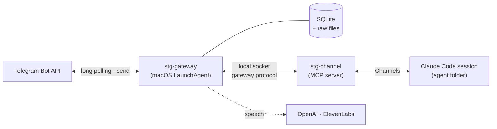

# smart-telegram-gateway

A smart and reliable gateway between Telegram and an AI agent that runs as a Claude Code session: nothing gets lost,
and your agent doesn't spend its turns on chores the gateway can do itself.

[Русская версия](README.ru.md) · [Changelog](CHANGELOG.md) · [Issues][issues]

## What it is and why

Talking to a personal agent through a Telegram bot sounds simple, until the agent's session is busy, compacting its
context, restarting, or the laptop is asleep. Then messages get lost, answered twice, or answered with no sign of
whether the agent even saw them.

smart-telegram-gateway is a small always-on service that owns the bot and stands between Telegram and the agent:

- **Your agent does only the work that needs it.** Receipts, the pinned status line, voice transcription, commands,
  episode bookkeeping, undo windows for reactions, rules updates for the agent — the gateway does
  all of this itself, deterministically. The agent spends its turns and tokens only on what needs thinking.
- **Nothing is lost.** Every message is written to a local SQLite database before Telegram is told it was received.
  If the agent is offline, messages wait; when it comes back, they are delivered in order. Delivery to the agent is
  at-least-once, with redelivery when the agent stays silent.
- **You can see what happens.** Reactions on your message show that the agent has seen it (👀) and answered it (👌).
  A pinned status line shows the current topic and the agent's state: online, working or offline, context used, usage
  limits, model failures.
- **Your words are kept apart from material.** Every event carries a trust label: your own words versus forwarded
  messages, other people and text inside images. The agent is told that material is never an instruction.
- **The gateway enforces access.** Who may talk to the agent, and in which role, is decided by the gateway from
  `rules.yaml`. The agent can narrow access at once; widening it needs your tap on a button.
- **Voice in, voice out.** Voice messages, video notes and audio files are transcribed (OpenAI or ElevenLabs); the
  transcript comes back to you as a quote. The agent can answer by voice.
- **Conversation in episodes.** Messages are grouped into episodes (topic × role) that close after a pause; you can
  stop, pause, start a new topic or ask "where are we" at any time.
- **The agent sees images and sends files.** It can look at photos and screenshots on request and send you documents
  from a dedicated parcels folder.

The agent connects through an adapter. Today the adapter is `stg-channel`, an MCP server that Claude Code loads as a
channel (Claude Code Channels) and that pushes events into a running session. The gateway ⇄ adapter protocol is
runtime-agnostic, so other agent runtimes can be added as adapters later.



The chat interface (gateway lines, `/help`, command names) and the agent's instructions are in Russian for now.

## Features by release

| Version | Highlights |
|---|---|
| 0.1.0 | Store-before-acknowledge intake, trust labels, commands and episodes, Claude Code channel adapter, voice with swappable providers, access rules, `stg` CLI, macOS installer |
| 0.2.0 | Receipts as reactions, pinned status line with the agent's context and usage limits, model failure notices, audio files up to 15 minutes |
| 0.3.0 | The agent looks at photos and screenshots (`media`), video notes and mp4 videos are transcribed |
| 0.3.1 | Quiet chat: commands in the menu, transcript as a reply to the voice message |
| 0.3.2 | 👀 / 👌 only, reply-source marks, relayed replies (`↪ Name:`), channel check only for a new session |
| 0.3.3 | Parcels: the agent sends files with `send_file` |
| 0.3.4 | Transcripts as quotes, owner reactions reach the agent, with an undo window |
| 0.3.5 | Current channel rules reach a resumed conversation; the confirmed topic line is deleted from the chat |

Details are in [CHANGELOG.md](CHANGELOG.md).

## Requirements

- **macOS.** The gateway runs as a per-user LaunchAgent and keeps secrets in the macOS Keychain.
- **Node.js ≥ 22.13** — the built-in `node:sqlite` module is used; there is no native database dependency.
- **Claude Code with Channels** (research preview). The agent session is started with
  `--dangerously-load-development-channels server:smart-telegram-gateway`; Claude Code asks for confirmation at each
  start, so the session is started by a person in a terminal window or in `tmux`.
- **A Telegram bot** and its token from [@BotFather](https://t.me/BotFather).
- **For voice (optional):** an OpenAI API key (the default provider) or an ElevenLabs key.

## Install

```sh
git clone <this repository> smart-telegram-gateway
cd smart-telegram-gateway
scripts/install-macos.sh <bot_username> [--node <path>] [--agent-dir <folder>] [--timezone <IANA zone>]
```

`scripts/install-macos.sh --help` shows the defaults. The script:

1. builds the repository (`npm ci` if needed, `npm run build`);
2. creates the bot directory `~/.smart-telegram-gateway/<bot>/` (mode 0700) with a minimal `config.yaml`;
3. writes the LaunchAgent plist (`stg service plist`), checks it with `plutil` and loads it with `launchctl`;
4. deploys the agent folder from the template (`stg agent-folder`);
5. prints the next steps.

Running it again reinstalls the service; `config.yaml`, `rules.yaml`, the database and the agent's notes are kept.
`scripts/uninstall-macos.sh <bot>` removes the service and leaves the data in place.

In the commands below, `stg` is the gateway CLI:

```sh
alias stg="node --disable-warning=ExperimentalWarning $PWD/packages/cli/dist/index.js"
```

Then finish the setup:

1. **Bot token** into the Keychain (the command prompts for it, without echo):
   `security add-generic-password -s smart-telegram-gateway -a <bot>/telegram -w`
2. **Voice key** (optional): `security add-generic-password -s smart-telegram-gateway -a openai -w`
3. **Owner.** While `owner_id` in `config.yaml` is empty, the gateway runs in first-run mode and ignores everyone.
   Send `/start` to your bot, run `stg doctor` — it shows your Telegram user id. Put it into `owner_id` and restart the
   service with the `launchctl kickstart -k …` command printed by the installer.
4. **Agent session.** Run `<agent folder>/start.sh` in a separate terminal window or in `tmux`, confirm the development
   channel prompt and, the first time, sign in with `/login`. The gateway sends a check event; the agent answers it by
   itself. A conversation continued with `start.sh --continue` does not get updated channel instructions from Claude
   Code, so the gateway sends them as a "channel rules" event (once per conversation and version); the agent marks it
   done.
5. `stg doctor` — every check should pass. `stg status` and `stg where` show what the gateway is doing.

## Agent folder template

`scripts/agent-folder/` is the template for the folder where the agent's Claude Code session lives:

| File | Purpose | On reinstall |
|---|---|---|
| `CLAUDE.md` | role instructions: notes, trust labels, `reply` / `done`, episodes, reactions, files | kept |
| `.mcp.json` | the `smart-telegram-gateway` MCP server (`stg-channel`) with paths filled in | rewritten |
| `.claude/settings.json` | permission mode `dontAsk` with an allow-list: channel tools, `Read`, `Grep`, `Glob`, `Edit` in `notes/` and `parcels/` | kept |
| `.claude/agent-state.settings.json` | status line command and `PreCompact` / `PostCompact` / `StopFailure` hooks that feed the agent icons in the pinned line | rewritten |
| `start.sh` | starts Claude Code with the channel and its own `CLAUDE_CONFIG_DIR` (`.claude-config/`) | rewritten |
| `notes/`, `parcels/` | the agent's notes; files the agent sends with `send_file` | kept |

This is not a sandbox: the agent runs as the same macOS user and can read the user's files, including the gateway's.
See [docs/THREAT-MODEL.md](docs/THREAT-MODEL.md). More about the template:
[scripts/agent-folder/README.md](scripts/agent-folder/README.md) (in Russian).

## Using it

Commands work from the ☰ menu, as slash commands or as plain words (in Russian): 📍 `/where` — where are we,
🆕 `/new` — new topic, ⏸ `/pause` (`/resume` to continue), ⛔ `/stop` (lifted with the button under the stop line),
📊 `/status`, ❓ `/help`.

What you see in the chat:

- 👀 on your message — the agent has it; 👌 — the agent answered or marked it done; nothing — the agent is offline and
  the message waits.
- The pinned line, for example `📍 #7 · Trip in May` and `🟢 · 🧠 16% · 🕐 31% · 📅 64%`: episode and topic; the
  agent idle 🟢, working 🟡, offline ⚪ or failing 🔴; `📥 N` waiting; context used (🌀 while compacting); 5-hour and
  weekly usage limits.
- `⚙ …` — a line from the gateway. A transcript comes as a quote in reply to your voice message. `↪ Name: …` — the
  agent relays someone else's words; `💬` marks an agent reply that would otherwise look like a gateway line.
- `⚙ ↪ #N · topic` with [верно] [не то] — the agent named or changed the topic. [верно] removes the line (the topic
  stays in the pinned line; `ui.delete_confirmed_topic`), [не то] brings the previous topic back.
- A reaction on an agent reply (👍, ❤, …) is passed to the agent after a short undo window.

The agent's tools (MCP): `reply`, `done`, `episode`, `episode_summary`, `where`, `rule`, `media`, `send_file`.

## Configuration

Settings live in `~/.smart-telegram-gateway/<bot>/config.yaml`. Unknown keys are an error, so typos do not pass
silently. Restart the service after editing. A fuller example:

```yaml
bot: my_assistant_bot
owner_id: 123456789              # your Telegram user id; empty = first-run mode
timezone: Europe/Berlin          # required

stt:                             # speech-to-text
  provider: openai               # openai (default) | elevenlabs
  model: gpt-4o-mini-transcribe
  key: openai                    # Keychain account (service "smart-telegram-gateway"); default = provider name
  language: ru
  vocabulary: [Acme, Kubernetes] # names and terms that help recognition
  audio_max_minutes: 15          # longer audio files are stored, not transcribed

tts:                             # replies by voice
  provider: openai
  model: gpt-4o-mini-tts
  voice: alloy

parcels:
  dir: null                      # null = parcels/ in the agent session's working directory
  targets: [telegram]

reactions:
  hold_seconds: 3                # undo window for your reactions; 0 = pass at once; at most 3

ui:
  where_ttl_minutes: 5           # how long the "where" answer stays in the chat
  delete_confirmed_topic: true   # [верно] under the topic line deletes the line; false = keep it as "… — верно"
```

Other providers:

```yaml
# OpenRouter — transcription only (its speech synthesis returns mp3/pcm, Telegram voice needs Ogg/Opus)
stt: { provider: openai, base_url: https://openrouter.ai/api/v1, model: openai/gpt-4o-transcribe, key: openrouter }

# ElevenLabs
stt: { provider: elevenlabs, model: scribe_v2, key: elevenlabs }
tts: { provider: elevenlabs, model: eleven_multilingual_v2, key: elevenlabs, voice_id: "<voice id>", output_format: opus_48000_64 }
```

Transcription and synthesis can use different providers. URLs must not contain credentials: keys live only in the
Keychain. `stg doctor` shows the provider, model and whether the key is present, never the key itself.

Further settings with defaults: `episode_idle_minutes` (33), `agent_offline_notice_minutes` (10),
`redeliver_after_minutes` (10), `closed_topics` and `closed_marker` (messages that never reach the agent), `retention`
(`owner_voice_days` 30, `untrusted_days` 90, `logs_days` 90, `closed_days` 30), `ui.role_short`. If Telegram refuses to
delete a confirmed topic line (older than 48 hours), the line is edited to "… — верно" without buttons instead. The full
reference is in [docs/TECH-SPEC.md](docs/TECH-SPEC.md), section 5.1.

**Access rules.** `rules.yaml` in the same directory lists subjects (people and their Telegram ids) and chats with
their space and role. The gateway writes it; your manual edits are read on restart and reported back to you in the chat.
The owner from `config.yaml` is always included and cannot be removed. The agent can change the rules with the `rule`
tool: narrowing applies at once, widening waits for your button (24 hours). `parcels: true` on a chat rule allows files
to that chat; on the `private` rule it allows files to the private chats of all listed subjects. `stg rules show`
prints the current rules and pending requests.

## Build and test

```sh
npm ci           # dependencies, pinned in package-lock.json
npm test         # tsc -b, then all unit and integration tests (node:test)
npm run build    # build only
node --disable-warning=ExperimentalWarning --test test/e2e/dist/m5-rules.test.js   # one file, after a build
```

The suite (about 700 tests, roughly two minutes) runs against fakes: a fake Telegram Bot API, a fake channel adapter, a
fake Claude Code client and fake speech providers, with a fake clock and fault injection points. Under test
(`STG_TEST=1`) the gateway never touches the real Telegram, speech providers, the Keychain or launchd. Temporary
directories are removed afterwards; set `STG_TEST_KEEP=1` to keep them. Unit tests sit next to the code
(`packages/*/src/*.test.ts`), integration tests are in `test/e2e/src/`.

Runtime dependencies are few: `zod`, `yaml`, `@modelcontextprotocol/sdk` and the `@grammyjs/types` type definitions.

## Release check

Before a release, scan the repository for data that must not be published:

```sh
STG_DENYLIST=/path/to/denylist.txt npm run release-check               # files git would commit
STG_DENYLIST=/path/to/denylist.txt npm run release-check -- --history  # plus every object and commit message in history
```

`scripts/release-check.mjs` has no dependencies. It reads a private denylist, kept outside the repository, from the
file named by `STG_DENYLIST`: one JavaScript regular expression per line, compiled with the flags `iu`; lines starting
with `#` are comments. Denylist patterns are also matched with invisible characters removed, so a name split by a
zero-width joiner is still found. Built-in checks need no list: home-directory paths under `/Users/`, e-mail
addresses, phone numbers, Telegram bot tokens, `sk-…` API keys, GitHub and AWS keys, private keys. Each finding is
printed as `file:line:match`; the exit code is 1 when anything is found. Without `STG_DENYLIST` only the built-in
checks run. With `--history`, author and committer lines are scanned too; set `STG_ALLOWED_AUTHOR="Name <email>"` to
accept the project's own commit identity; the same name is also accepted on `Copyright` lines.

## Packages

| Path | What |
|---|---|
| `packages/core` | shared core: clock, fault points, config and rules, secrets, database and migrations, gateway ⇄ adapter protocol, strings, voice providers (OpenAI-compatible, ElevenLabs), images, parcels |
| `packages/gateway` | `stg-gateway` service: Telegram intake, sender, reactions, pinned status line, commands, episodes, access rules, voice, images, parcels, socket server for adapters |
| `packages/channel` | `stg-channel`: MCP server for Claude Code Channels — events into the session, tools for the agent |
| `packages/cli` | `stg` CLI: `doctor`, `status`, `where`, `rules show`, `backup`, `restore`, `deferred`, `log tail`, `service plist`, `agent-folder`, `agent-state` |
| `scripts/` | `install-macos.sh`, `uninstall-macos.sh`, `launchd/gateway.plist.template`, `agent-folder/` template, `release-check.mjs` |
| `test/fake-telegram`, `test/fake-channel`, `test/fake-elevenlabs` | fakes of the Telegram Bot API, the channel adapter and the speech providers (ElevenLabs and OpenAI dialects) |
| `test/e2e` | integration tests: the gateway as a child process against the fakes |

## Documentation

The design documents are in Russian for now.

| Document | What |
|---|---|
| [docs/ARCHITECTURE.md](docs/ARCHITECTURE.md) | architecture decisions AD-1…AD-10: what, why, what was rejected, consequences |
| [docs/TECH-SPEC.md](docs/TECH-SPEC.md) | implementation spec: configuration, database schema, intake order, protocol, tools, CLI |
| [docs/THREAT-MODEL.md](docs/THREAT-MODEL.md) | threat model and what is not protected yet |
| [docs/ACCEPTANCE.md](docs/ACCEPTANCE.md) | acceptance criteria and their mapping to tests |
| [docs/WORKFLOWS.md](docs/WORKFLOWS.md) | the gateway's internal loops and state machines |
| [docs/img/](docs/img/) | diagrams (SVG, generated by `gen.py`) |
| [CHANGELOG.md](CHANGELOG.md) | changes by release |

## Status

Version 0.3.5, pre-1.0. It is built for one owner, one bot and one agent on one Mac. Groups and other people are
modelled in the data and the access rules, but there is no interface for them yet. The agent runs without a sandbox
(see the threat model). Expect breaking changes before 1.0; database migrations run automatically, and rolling back
needs a backup (`stg backup`).

## License

[Apache License 2.0](LICENSE); see [NOTICE](NOTICE). Contributions are welcome — see [CONTRIBUTING.md](CONTRIBUTING.md).

Copyright 2026 Taras Pustovoy

## Issues

Bug reports and questions: [GitHub Issues][issues].

[issues]: https://github.com/tvpustovoy/smart-telegram-gateway/issues
