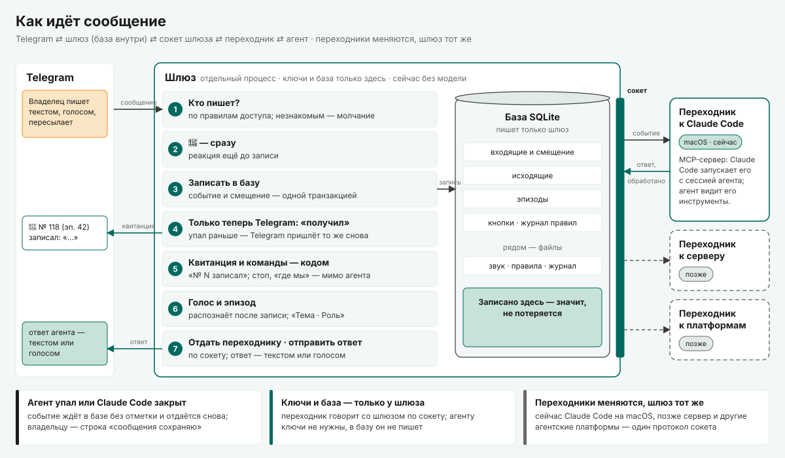
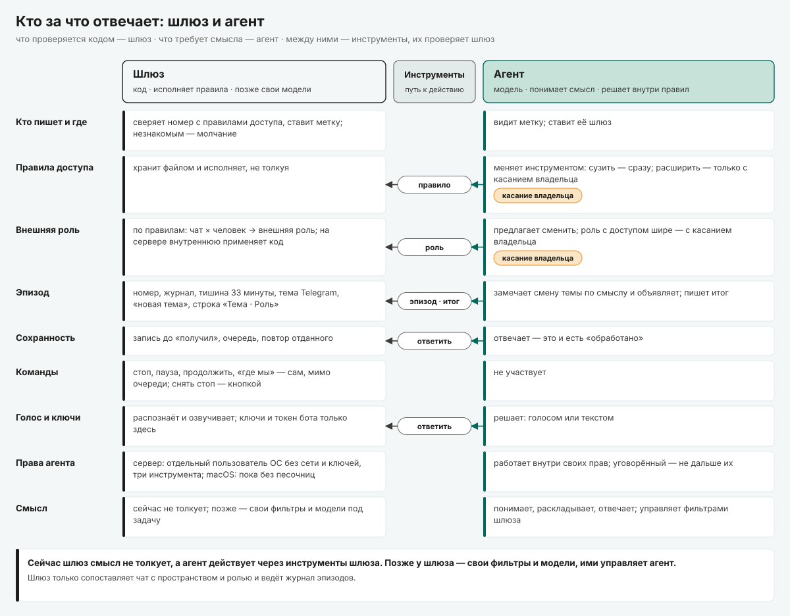

# smart-telegram-gateway — архитектурные решения

*Архитектурные решения шлюза. Работы, которым он служит (J-1…J-9), — ниже; реализация версии 0.1 — `TECH-SPEC.md`,
угрозы — `THREAT-MODEL.md`, приёмка — `ACCEPTANCE.md`. Решения пронумерованы AD-1…AD-10, в скобках — справочное
английское имя. Заголовок — что делаем; дальше: решение подробно · контекст · что отклонили · последствия (+ выигрыш,
− цена) · каким работам служит · когда принято.*

*Слова. **Адаптер** (в `TECH-SPEC.md` и на схемах — переходник) — процесс агентной среды, подключённый к сокету шлюза.
**Протокол шлюза** — то, что шлюз и адаптер говорят друг другу через этот сокет; инструменты агента (`reply`, `rule`,
`episode`…) работают через него. **Канал** — только механизм Channels в Claude Code (AD-5). **Сессия шлюза** —
бессрочный разговор с владельцем (AD-8); **сессия Claude Code** — запущенный процесс агента.*

---

## Работы

У шлюза два клиента: **владелец** — человек, который говорит со своим агентом через Telegram, и **агент**, который
получает через шлюз сигналы и через него отвечает. Работы пронумерованы J-1…J-9; на них ссылаются решения ниже,
`TECH-SPEC.md` (строки **Служит:**) и `ACCEPTANCE.md`.

| № | Работа | Чья |
|---|---|---|
| J-1 | Передать мысль и не потерять её (`capture`): написать агенту с телефона, чтобы мысль не потерялась и агент быстро откликнулся | владелец |
| J-2 | Надиктовать голосом (`dictate`): говорить с агентом голосом и видеть, что расслышано верно | владелец |
| J-3 | Отвечать по месту (`reply-thread`): ответить на конкретное сообщение — агента или своё, — и получать ответ агента на конкретное своё | владелец |
| J-4 | Видеть, как агент меня понял (`topic-check`): о какой теме и из какой роли агент сейчас говорит | владелец |
| J-5 | Решать, кто пишет моему агенту (`gatekeep`): до агента доходят только те, кого пустил владелец; правила ведёт агент, исполняет шлюз | владелец |
| J-6 | Переслать чужое как материал (`forward-material`): указания внутри чужого сообщения не срабатывают как слова владельца | владелец |
| J-7 | Остановить агента (`stop`): одним словом, чтобы от его имени больше ничего не ушло, даже если он сбился | владелец |
| J-8 | Получать очищенный сигнал (`agent-signal`): агент получает уже обработанные сигналы и думает, а не держит канал | агент |
| J-9 | Отвечать и вести тему (`agent-reply`): агент отвечает владельцу текстом или голосом и называет тему разговора | агент |

---

## Обзор

| # | Решение | Служит |
|---|---|---|
| AD-1 | Связь с Telegram держит отдельный процесс — шлюз; агент работает с ним через свой адаптер, подключённый к сокету шлюза | J-1, J-2, J-8 |
| AD-2 | Получение сообщения подтверждаем Telegram только после записи в базу; повторы отсекаем | J-1 |
| AD-3 | Очередь и состояние в версии 0.1 храним в SQLite, звук, правила и журнал — в файлах; пишет только шлюз | J-1, J-8 |
| AD-4 | Агентные среды подключаем сменными адаптерами по одному протоколу шлюза через локальный сокет | J-8, J-9 |
| AD-5 | В Claude Code доставляем события через его механизм Channels, без отдельного монитора; обработанным событие считаем по ответу агента | J-8, J-1 |
| AD-6 | Привилегии — кто и что может делать — применяет шлюз; редактировать их можно и через агента | J-5, J-6, J-7 |
| AD-7 | Каждой части сообщения ставим метку происхождения: слово владельца, чужое, своё пересланное | J-6, J-8 |
| AD-8 | Эпизоды — сервис шлюза: он хранит эпизоды и базовую логику, агент может ими управлять | J-4, J-9 |
| AD-9 | Справочник участников в шлюзе: кто есть кто и рабочая копия их прав | J-5 |
| AD-10 | Версию 0.1 запускаем на машине владельца (macOS), без изоляции на уровне ОС | все — проверка в эксплуатации |

J-3 (реплаи) отдельного решения не требует — `TECH-SPEC.md` 5.5а.

---

## Решения

### AD-1. Связь с Telegram держит отдельный процесс — шлюз; агент работает с ним через свой адаптер (`separate-service`)

- **Решение.** Шлюз — самостоятельный долгоживущий процесс: на ноутбуке — пользовательская служба launchd, на сервере —
  системная служба. Только он опрашивает Telegram Bot API и отправляет в него сообщения; токен бота и ключи
  распознавания и синтеза речи есть только у него. Агент с Telegram не соединяется. Шлюз слушает локальный Unix-сокет;
  к нему подключается адаптер агентной среды (AD-4). У Claude Code адаптер — MCP-сервер, который Claude Code запускает
  вместе с сессией агента (AD-5); агент видит только его инструменты. Цепочка: Telegram ⇄ шлюз (HTTPS, длинный опрос) ⇄
  адаптер (Unix-сокет) ⇄ сессия агента (MCP). Голос шлюз распознаёт и синтезирует сам, через внешнего провайдера: агент
  получает текст. На бота — один экземпляр шлюза: второй при старте находит живой сокет и выходит.
- **Контекст.** Агент закрывается, падает, перезапускается; приём сообщений от этого зависеть не должен.
- **Отклонено.** Telegram внутри сессии агента — официальный плагин Telegram для Claude Code: приём живёт, пока открыта
  сессия. Telegram внутри харнеса — платформа Telegram в Hermes. Коннектор внешней агентской платформы — отдельный мост,
  но зависит от её демона: при падении демона под работающим мостом входящее теряется.
- **Последствия.** + Приём не зависит от того, запущен ли агент; секреты агенту не передаются (на ноутбуке это ещё не
  изоляция — AD-10). − Ещё один процесс в эксплуатации. Резерва нет: приём доступен, пока жив один процесс; простой
  покрывает буфер Telegram (24 часа, AD-2). Звук владельца уходит внешнему провайдеру распознавания.
- **Служит** J-1, J-2, J-8 · **принято** 2026-10-16.

### AD-2. Получение сообщения подтверждаем Telegram только после записи в базу; повторы отсекаем (`store-before-ack`)

- **Решение.** Смещение опроса (`offset`) хранится в базе и продвигается в той же транзакции, что и запись события;
  следующий `getUpdates` с новым смещением уходит только после фиксации транзакции — это и есть подтверждение для
  Telegram. Повторно пришедшее обновление отсекается по `update_id`: приём идемпотентен, каждое сообщение лежит в базе
  ровно один раз. Всё долгое — распознавание голоса, скачивание файлов — идёт после записи, вне пути подтверждения
  ⟨предл.⟩.
- **Контекст.** Telegram хранит неподтверждённые обновления до 24 часов и отдаёт их снова.
- **Отклонено.** Встроенные циклы опроса библиотек: aiogram и python-telegram-bot подтверждают обновление до обработки,
  grammY — после обработчика, но при ошибке и остановке подтверждает необработанное. Из семи готовых мостов Telegram ↔
  агент, разобранных по коду, у шести подтверждение идёт раньше записи; седьмой (Headcrab/telecodex) пишет обновление и
  смещение одной транзакцией — этот приём мы и берём.
- **Последствия.** + Падение шлюза в любой момент не теряет принятое; зависший провайдер распознавания не держит приём.
  − Свой цикл опроса вместо библиотечного; простой дольше 24 часов ведёт к потере — это предел Telegram.
- **Служит** J-1 · **принято** 2026-10-17.

### AD-3. Очередь и состояние в версии 0.1 храним в SQLite, звук, правила и журнал — в файлах (`one-queue-sqlite`)

- **Решение.** В одной встроенной базе SQLite: входящие события и смещение, исходящие, эпизоды, справочник участников,
  одноразовые кнопки, история изменений правил, задержки. Режим WAL, `synchronous = FULL` и `fullfsync`: на macOS
  коммит доходит до носителя, а не до кэша диска. Пишет в базу только процесс шлюза; адаптеры работают через сокет, CLI
  открывает базу только на чтение. Рядом, файлами: звук голосовых (`raw/`, в базе — ссылка), правила доступа
  (`rules.yaml`, пишет только шлюз), настройки (`config.yaml`), журнал сообщений (`logs/`). Текст и расшифровка — в
  базе. Секреты — в связке ключей.
- **Контекст.** Один узел, один владелец, десятки–сотни сообщений в день; нужна атомарная запись «событие + смещение».
- **Отклонено.** Очередь в каталогах файлов — связку «событие + смещение + статус» из нескольких файлов пришлось бы
  делать атомарной вручную. Брокер сообщений (Redis, NATS, RabbitMQ) —
  отдельный сервис и точка отказа без выигрыша на одном узле.
- **Последствия.** + Транзакции, простое резервное копирование, ноль дополнительных сервисов. − После подтверждения
  Telegram база — единственная копия принятого: потеря файла теряет всё, что пришло после последней копии `stg backup`.
  Исходящие уходят «как минимум один раз»: падение между отправкой и отметкой «отправлено» даёт владельцу повтор.
  Масштаб — один узел.
- **Служит** J-1, J-8 · **принято** 2026-10-17 (база SQLite) и 2026-10-18 (очередь в первой версии — на SQLite и файлах).

### AD-4. Агентные среды подключаем сменными адаптерами по одному протоколу шлюза (`swappable-adapters`)

- **Решение.** Ядро шлюза (приём, хранилище, правила, эпизоды, отправка) ничего не знает об агентной среде (харнесе).
  Порт — версионируемый протокол шлюза: локальный Unix-сокет, кадр — строка JSON, версия согласуется при подключении.
  Адаптер — отдельный процесс на стороне среды: он подключается к сокету и берёт аренду, а шлюз по этому соединению сам
  присылает ему события — строго по номерам — и принимает ответы и отметки «обработано». В базу адаптер не пишет.
  События получает один адаптер за раз; аренда держится, пока он отвечает на проверку связи. В 0.1 — адаптер Claude
  Code; далее — Agent SDK на сервере, Hermes, DeepSeek Harness и другие агентные платформы.
- **Контекст.** Агентные среды меняются быстрее, чем Telegram; шлюз должен работать с разными средами — с одной на бота
  за раз; другому агенту — свой бот и свой экземпляр шлюза.
- **Отклонено.** Шлюз, встроенный в конкретный харнес.
- **Последствия.** + Смена или обновление харнеса затрагивает только адаптер. − Протокол нужно держать стабильным и
  версионировать. Адаптер работает на той же машине, что и шлюз; в 0.1 он не предъявляет ключа — аренду может взять
  любой процесс пользователя, которому открыт каталог шлюза (права 0700).
- **Служит** J-8, J-9 · **принято** 2026-10-17.

### AD-5. В Claude Code доставляем события через его механизм Channels, без отдельного монитора (`channel-not-monitor`)

- **Решение.** Адаптер Claude Code — MCP-сервер с возможностью канала (Channels). Claude Code запускает его вместе с
  сессией агента; адаптер получает события от шлюза по сокету и вставляет их в сессию. Claude Code не подтверждает
  получение событий канала и молча отбрасывает их, если сессия открыта без флага канала. Поэтому событие считается
  обработанным только после ответа или отметки агента через инструменты адаптера; без неё — повторная доставка. Сессию
  без канала адаптер распознаёт пробным событием.
- **Контекст.** Сессию Claude Code нужно будить на входящее сообщение, сохраняя её контекст.
- **Отклонено.** (1) Новый процесс агента на каждое сообщение — долгий подъём и потеря контекста (проверено на
  практике). (2) Возобновление прежней сессии на каждое сообщение — длинный контекст грузится непредсказуемо долго.
  (3) Фоновый монитор, который следит за очередью и будит сессию, — лишний компонент.
- **Последствия.** + Нет отдельного процесса для пробуждения. − Доставка агенту — «как минимум один раз»: событие без
  отметки приходит снова, в том числе когда дело уже сделано; от повтора действия защищает пометка повтора и проверка
  агентом, а не код. Channels — исследовательская версия: флаг разработчика, только интерактивный запуск, контракт может
  измениться. Риск изолирован в адаптере; сообщения при его сбое остаются в базе.
- **Служит** J-8, J-1 · **принято** 2026-10-16…17.

### AD-6. Привилегии — кто и что может делать — применяет шлюз; редактировать их можно и через агента (`gateway-enforces-privileges`)

- **Решение.** Шлюз — точка применения привилегий: на каждое сообщение он кодом проверяет, кто пишет (числовой id
  Telegram сверяется со справочником участников, AD-9), в каком чате и что этому участнику разрешено. Проверка идёт до
  того, как текст попадёт к модели; команды («стоп», «пауза», «где мы») исполняются в обход агента. В 0.1 привилегий
  две: писать агенту — по правилам доступа; подавать команды — только владелец, он задан конфигурацией, и правилами его
  не отнять. Правила меняет агент через протокол шлюза (инструмент `rule`): сужение применяется сразу, расширение —
  только после кнопки владельца. Владелец в 0.1 может и сам поправить файл правил (читается при перезапуске).
- **Контекст.** Модель можно уговорить текстом; решение о доступе не должно от этого зависеть, а держать правила в
  актуальном виде удобно агенту.
- **Отклонено.** Решения о доступе на стороне агента (модели).
- **Последствия.** + Посторонний не доставит агенту ни слова. После «стоп» шлюз не отдаёт агенту новых событий и не
  отправляет в Telegram ни одного его ответа — при любом состоянии модели. Уговорённый агент не расширит доступ без
  кнопки владельца — через протокол шлюза; на ноутбуке обход протокола сдерживают только права сессии (AD-10).
  − «Стоп» не прерывает идущий ход: на ноутбуке агент дорабатывает его и может писать файлы, а после [продолжить] этот
  ход ещё может ответить; прерывание процесса агента — на сервере. Чужой текст, который владелец сам переслал, до
  модели доходит: шлюз его не отсекает, а помечает (AD-7).
- **Развитие.** Позже в шлюзе могут появиться свои фильтры и модели под задачу; управлять ими будет агент.
- **Служит** J-5, J-6, J-7 · **принято** 2026-10-17 (жёсткие правила в шлюзе, управляет агент) и 2026-10-18
  (формулировка через привилегии).

### AD-7. Каждой части сообщения ставим метку происхождения: слово владельца, чужое, своё пересланное (`trust-labels`)

- **Решение.** Шлюз кодом помечает происхождение каждой части события: собственный текст или голос владельца в личке —
  «слово владельца»; пересланное от других, цитата или ответ из другого чата, любой файл и снимок экрана — «чужое»; своё
  старое сообщение, пересланное владельцем заново, — «своё пересланное» (материал, не команда). Сообщение через
  инлайн-бота — «чужое» целиком: его текст составил бот. Если к слову владельца
  приложено чужое, сообщение помечается смешанным. Метка передаётся агенту; итог эпизода, где было чужое, шлюз помечает
  сам, заметки — агент по правилу роли.
- **Контекст.** Владелец пересылает чужие тексты как материал; указания внутри них не должны выдаваться за его слово.
- **Отклонено.** Считать словом владельца всё, что пришло с его номера.
- **Последствия.** + Агент видит, где слово владельца, а где материал; пересланное никогда не становится командой шлюза
  (AD-6). − Для модели метка — подсказка, а не запрет: исполнит ли агент указание внутри чужого, решает модель; предел
  ставят права сессии (AD-10). Скопированный вручную чужой текст и чужая речь в голосовом владельца получают метку
  «слово владельца».
- **Служит** J-6, J-8 · **принято**: метки (Ш-4, Ш-20, Ш-25) — 2026-10-17, работа J-6 — 2026-10-18.

### AD-8. Эпизоды — сервис шлюза: он хранит эпизоды и базовую логику, агент может ими управлять (`episodes-as-service`)

- **Решение.** Разговор с владельцем — одна бессрочная сессия шлюза, внутри неё эпизоды (тема × внешняя роль). Шлюз ведёт
  эпизоды как сервис: хранит их историю и итоги, показывает владельцу «Тема · Роль», применяет правила по умолчанию —
  33 минуты тишины, команда «новая тема», тема Telegram открывают новый эпизод. Агент управляет эпизодами через
  протокол шлюза (инструмент `episode`), когда это нужно: называет тему, открывает новый эпизод; дальше — больше операций по мере надобности. Владелец
  подтверждает или отклоняет смену кнопками.
- **Контекст.** Владельцу нужно видеть, как агент понял разговор; при этом учёт эпизодов не должен зависеть от того,
  запущен ли агент.
- **Отклонено.** Эпизоды целиком на стороне модели; полноценные «комнаты» с повесткой и журналом решений.
- **Последствия.** + Эпизоды учитываются и видны владельцу, даже когда агент выключен; агенту не нужно держать эту
  логику в себе. − На ноутбуке эпизод — только учёт и видимость: разговор Claude Code по эпизодам не делится, контекст
  общий и сжимается самим Claude Code; эпизод как граница контекста — у серверного адаптера. Пока агент не назвал тему,
  эпизод называется «Новая тема».
- **Служит** J-4, J-9 · **принято** 2026-10-16…17 (эпизоды, 33 минуты) и 2026-10-18 (эпизоды как сервис, агент может
  управлять).

### AD-9. Справочник участников в шлюзе: кто есть кто и рабочая копия их прав (`participants-directory`)

- **Решение.** Часть шлюза — справочник участников. Он хранит, кто есть кто: связывает аккаунт в Telegram (позже — и в
  других сетях) с участником, каким его знает модель мира агента (по ссылке, без содержимого модели мира), и держит
  рабочую копию его прав: по ней, и только по ней, AD-6 проверяет каждое сообщение, даже когда агент выключен. Меняется
  копия через протокол шлюза — сужение сразу, расширение после кнопки владельца — или правкой файла правил владельцем
  (AD-6); изменение в модели мира агента само прав не меняет. Внешние системы (агентские платформы, другие сети) —
  только транспорт.
- **Контекст.** Позже к боту добавятся члены семьи и группы; адреса во внешних системах меняются.
- **Отклонено.** Брать идентичности и адресацию из внешней агентской платформы.
- **Последствия.** + Смена или сброс внешней системы не теряет людей и маршруты (новая версия внешней платформы может
  не перенести данные прежнего формата — личности, ключи и контакты пришлось бы заводить заново); новый участник —
  запись в справочнике, а не код. − Связку с моделью мира агента нужно поддерживать.
- **Служит** J-5 · **принято** 2026-10-17 (идентичности свои) и 2026-10-18 (справочник: кто есть кто, связь с моделью
  мира, копия прав).

### AD-10. Версию 0.1 запускаем на машине владельца (macOS), без изоляции на уровне ОС (`laptop-first`)

- **Решение.** Версия 0.1 работает на постоянно работающем ноутбуке под macOS: шлюз — пользовательская служба
  launchd; агент — интерактивная сессия Claude Code в отдельной папке со своим каталогом
  настроек (`CLAUDE_CONFIG_DIR`). Шлюз и агент работают под одним пользователем macOS.
- **Контекст.** Нужна проверка в эксплуатации как можно раньше; проверка на ноутбуке показывает надёжность и удобство,
  а не защиту.
- **Отклонено и отложено.** Сразу сервер с изоляцией. Песочница агента или отдельный пользователь macOS для шлюза —
  отложены (пока без песочниц).
- **Последствия.** + Эксплуатация начинается быстро. − Без изоляции защищён только вход: отсев посторонних и
  команды — код шлюза, они держатся и здесь. Сам шлюз от агента защищают только права сессии Claude Code: с
  предложенным списком разрешённого (инструменты шлюза, чтение, запись только в папку заметок, без командной строки)
  агент может читать файлы шлюза, включая тексты сообщений; без него — ещё и переписать правила, базу и код шлюза и
  достать токен бота из связки ключей. Агент на связи, только пока его сессию открыл человек и ноутбук не спит. Сервер
  с изоляцией — после проверки в эксплуатации (#8).
- **Служит** проверке всех работ в эксплуатации · **принято** 2026-10-17 (ноутбук, без песочниц) и 2026-10-18
  (отдельная конфигурация).

---

## Открыто

Обсуждение открытых решений — в [GitHub issues](https://github.com/tvpustovoy/smart-telegram-gateway/issues).

- ~~Язык реализации~~ — решено: TypeScript на Node (на нём Agent SDK, MCP-сервер канала Claude Code и DeepSeek
  Harness; SQLite встроена в Node).
- **Права сессии агента на ноутбуке** — предложен режим `dontAsk` со списком разрешённого (`TECH-SPEC.md` 5.11): без
  командной строки, запись только в папку заметок. От него зависит, что остаётся от защиты шлюза (AD-10). Ждёт
  решения — #37.
- **Серверная площадка** (адаптер Agent SDK, круглосуточная работа, изоляция на уровне ОС) — отдельное решение после
  проверки в эксплуатации (#8).
